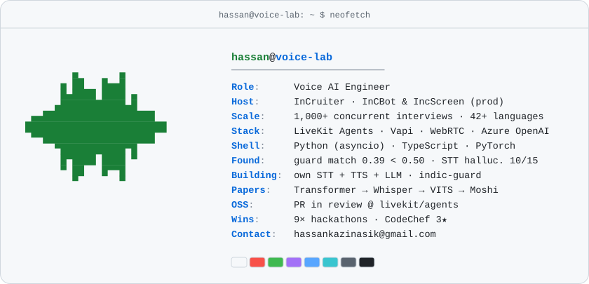

<!--
  Profile README v2 for github.com/ANDROIDHASSAN  (repo: ANDROIDHASSAN/ANDROIDHASSAN)
  Upload the whole folder: README.md, assets/, scripts/, .github/workflows/
  Delete the old stray file "Hi, I'm @ANDROIDHASSAN" from the repo.

  HONESTY RULES (same as the resume):
  - Status stays honest: prod / building / next / planned.
  - Project names stay plain text until the repo is public with working code; then make them links.
  - The "Recently pushed" block is filled by a GitHub Action from your real repos. Never edit it by hand.
-->

<a href="https://hassankazi3d.netlify.app">
  <picture>
    <source media="(prefers-color-scheme: dark)" srcset="./assets/hero-dark.svg">
    
  </picture>
</a>

<samp>
  <a href="https://hassankazi3d.netlify.app">portfolio</a> ·
  <a href="https://linkedin.com/in/erhassankazi">linkedin</a> ·
  <a href="mailto:hassankazinasik@gmail.com">email</a> ·
  <a href="#building-in-public">building in public</a> ·
  <a href="#rebuilding-the-ai-stack-from-the-papers-up">papers</a>
</samp>

<picture>
  <source media="(prefers-color-scheme: dark)" srcset="./assets/neofetch-dark.svg">
  
</picture>

I build real-time voice agents. At [InCruiter](https://incruiter.com) I lead the AI & real-time stack behind **InCBot** and **IncScreen**, AI interviewers running **1,000+ concurrent interviews in 42+ languages**. In production I found English-only guards scoring Devanagari replies **0.39 against a 0.5 threshold**, and Marathi STT **hallucinating in 10 of 15 turns**. Everything below starts from bugs like these.

<picture>
  <source media="(prefers-color-scheme: dark)" srcset="./assets/pipeline-dark.svg">
  
</picture>

### Building in public

| Project | What it is | Status |
|---|---|---|
| `own-voice-models` | My own Hindi/Marathi STT + TTS and a LoRA-tuned LLM, joined by a from-scratch streaming orchestrator (VAD, end-of-turn, barge-in) | building |
| `indic-guard` | Script-aware text matching for Devanagari, romanized and code-mixed text, born from the 0.39 bug | next |
| `indic-voice-bench` | Open benchmark of STT/TTS models on Hindi, Marathi and Hinglish phone audio | next |
| `hinglish-turn-detector` | End-of-turn model for code-mixed speech, as a LiveKit Agents plugin | planned |
| `bhasha-bridge` | Marathi ↔ English phone calls where each side hears their own language | planned |

<table><tr><td valign="top" width="50%">

#### Recently pushed
<!-- recent_pushes starts -->
_Updates automatically every day from my public repos._
<!-- recent_pushes ends -->

</td><td valign="top" width="50%">

#### Writing
- *Why voice agents break on Hindi: 4 failure modes* (draft)

#### Open source
- Next: [livekit/agents](https://github.com/livekit/agents) — Indic fixes in the Sarvam plugin
<!-- After your first merged PR, change this line to: "Merged PRs in livekit/agents: <link to PR list>" -->

</td></tr></table>

### Rebuilding the AI stack from the papers up

| LLM | ASR | TTS | Audio |
|---|---|---|---|
| Transformer · BPE | Whisper | VITS + HiFi-GAN | SoundStream (RVQ) |
| LLM.int8 · GPTQ · FlashAttention | Conformer + RNN-T | StyleTTS 2 | Moshi |
| LoRA · DPO · GRPO · speculative decoding | wav2vec 2.0 | F5-TTS | Voice Activity Projection |

One repo per paper, each with notes on what I learned. Earlier I shipped CRMs like [Interify](https://interify.in) and [CupCount](https://www.cupcount.in), and won 9 hackathons.

<samp>
  hassan@voice-lab:~$ <a href="mailto:hassankazinasik@gmail.com">say hello</a>
</samp>

