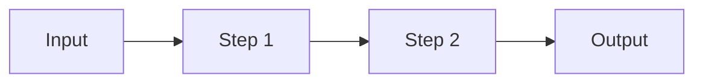

<!--
  README template for every project repo (own-voice-models, indic-guard, indic-voice-bench, ...).
  Copy it into the repo as README.md and fill each [BRACKET].
  Delete any section you have nothing real for. A short, true README beats a long one.
  Order matters: a reviewer decides in ~30 seconds, so the result and the demo come first.
-->

# [repo-name]

[One sentence: what it does and for whom.]
*Example: Script-aware text matching for voice agents that handle Devanagari, romanized and code-mixed Hindi.*

[](https://pypi.org/project/[package]) [](LICENSE)

<!-- Demo first: a 20-40 s GIF or video link. For voice projects, a short screen recording with audio on YouTube/Loom. -->
[DEMO GIF / VIDEO LINK]

## Results

<!-- Only measured numbers. Say what you measured on and how. -->

| Metric | Baseline | This repo | Measured on |
|---|---|---|---|
| [WER / latency p50 / match accuracy] | [value] | [value] | [dataset or setup, e.g. IndicVoices Marathi test, 500 clips] |

## Why this exists

[2-4 lines. The real problem, ideally one you hit yourself.]
*Example: In production, an English-only text guard scored Devanagari replies 0.39 against a 0.5 threshold, so correct answers were rejected.*

## Quickstart

```bash
pip install [package]        # or: git clone + uv sync
```

```python
# the smallest example that shows the main idea working
```

## How it works

<!-- A small diagram beats a paragraph. GitHub renders mermaid. -->



[3-6 lines on the key design choices and trade-offs.]

## Reproduce the results

```bash
[exact commands to download data, run eval, print the results table]
```

## Based on

- [Paper title], [Authors] ([year]). [arxiv.org/abs/XXXX.XXXXX](https://arxiv.org/abs/XXXX.XXXXX)
- [Dataset / model credit and its licence]

## What I learned

<!-- 3-5 bullets. This is the part founders and researchers actually read. -->
- [Something that surprised you]
- [Something that did not work, and why]

## Roadmap

- [ ] [Next concrete step]

## License

MIT
